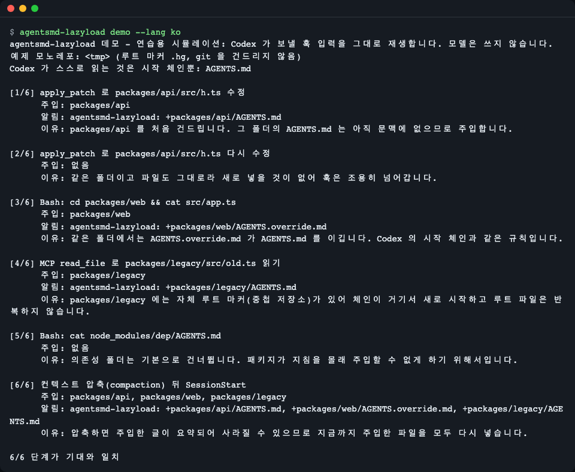
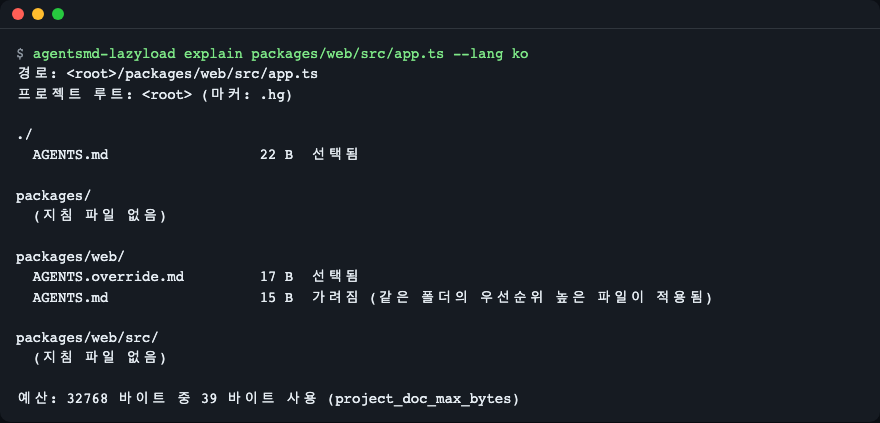
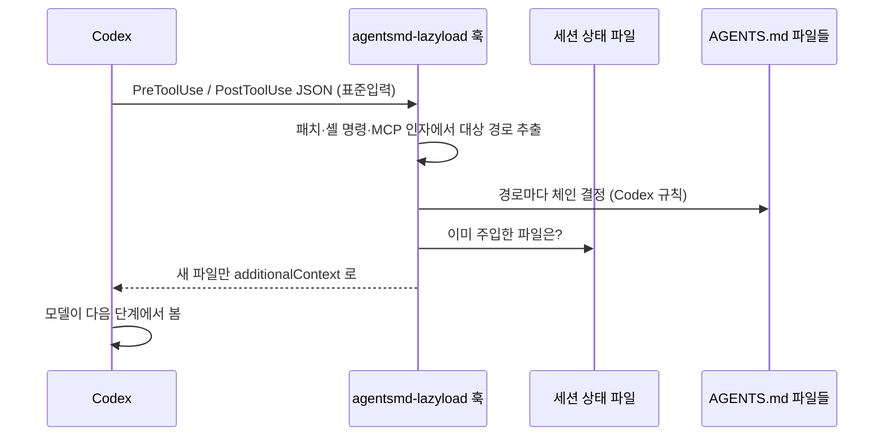

# agentsmd-lazyload

[English](README.md) | **한국어**

하위 폴더의 `AGENTS.md` 를 도구 호출이 그 폴더를 처음 건드릴 때 모델 문맥에 넣어 주는 Codex 훅입니다. 모노레포 루트에서 연 세션도 패키지별 지침을 따르게 됩니다. Codex 자신의 체인 규칙을 따르고 API 키와 네트워크가 필요 없습니다. 설치는 `npm i -g agentsmd-lazyload && agentsmd-lazyload install` 입니다.

Codex 는 `AGENTS.md` 체인(프로젝트 루트부터 실행한 폴더까지)을 세션을 시작할 때 한 번만 만듭니다. 저장소 루트에서 Codex 를 열고 `packages/api/` 를 고치면 `packages/api/AGENTS.md` 는 끝까지 읽히지 않습니다([openai/codex#12115](https://github.com/openai/codex/issues/12115), 열림, 2026-11-20 확인). 이 훅이 세션이 도는 동안 그 빈틈을 메웁니다.


*`agentsmd-lazyload demo`: 임시 모노레포에서 샘플 훅 입력 6건을 재생합니다. 연습용 시뮬레이션이며 모델은 쓰지 않습니다.*

## 무엇을 더해 주나요

- 도구 호출(`apply_patch`, 셸 명령, MCP 도구)이 어떤 폴더를 처음 건드릴 때 그 폴더의 하위 `AGENTS.md` 를 주입합니다.
- Codex 의 규칙을 따릅니다: `AGENTS.override.md` 가 `AGENTS.md` 보다 우선, 그다음 `project_doc_fallback_filenames`, 빈 파일은 무시, `project_root_markers` 와 중첩 저장소가 경계, `project_doc_max_bytes` 로 자르기.
- 세션마다 주입한 것을 기억해 같은 파일을 두 번 넣지 않고, 컨텍스트 압축(compaction) 뒤에는 다시 넣습니다.

## 요구 사항

| 호스트 | 확인한 버전 | 비고 |
|---|---|---|
| Codex CLI | 0.154.0 | 훅은 `~/.codex/hooks.json` 또는 `<프로젝트>/.codex/hooks.json` 에서 읽습니다. 훅은 한 번 신뢰(trust)해야 합니다(아래 참고). |
| Node.js | 26.13.0 (22 이상 필요) | 설치: `brew install node` 또는 [nodejs.org](https://nodejs.org/). |

## 설치

전역 설치 뒤 훅을 등록합니다.

```bash
npm i -g agentsmd-lazyload
agentsmd-lazyload install            # ~/.codex/hooks.json 에 씀
# 한 저장소에만:
agentsmd-lazyload install --project  # <프로젝트 루트>/.codex/hooks.json 에 씀
```

먼저 미리 보기(아무것도 쓰지 않음):

```bash
agentsmd-lazyload install --project --dry-run
```

추가할 이벤트 3개와 전체 `hooks.json` 을 출력합니다(실제 출력은 영어 `--lang en` 기준):

```
Dry run: nothing was written. This is what install would do:
  + PreToolUse
  + PostToolUse
  + SessionStart
```

그다음 Codex 를 시작하고 `/hooks` 를 열어 새 훅을 검토하고 신뢰하세요. **신뢰하기 전에는 훅이 아무것도 하지 않습니다.**

`install` 이 추가한 것만 지우려면 `agentsmd-lazyload uninstall`(저장소 파일은 `--project`). 다른 훅은 그대로 남습니다.

npm 대신 clone 으로 설치:

```bash
git clone https://github.com/LeeGyeongPil/agentsmd-lazyload.git
cd agentsmd-lazyload
npm install          # prepare 스크립트가 dist/ 를 빌드
node dist/cli.js install
```

`--project` 는 하위 폴더에서 실행해도 프로젝트 루트(`.git` 이 있는 폴더 또는 `project_root_markers`)에 쓰고 고른 경로를 출력합니다. `install` 은 폴더 이름과 상관없이 명령 모양으로 자기 항목을 알아보므로 두 번 실행해도 중복이 생기지 않고, `uninstall` 은 그 항목만 지웁니다.

`agentsmd-lazyload` 가 `PATH` 에 없으면 `install` 은 `node` 와 `cli.js` 의 절대 경로를 `hooks.json` 에 쓰고 알려 줍니다. 옮기거나 업그레이드했다면, 또는 `node` 경로가 바뀌었다면(예: `brew upgrade node`) `install` 을 다시 실행하세요.

## 사용법

### Codex 없이 해 보기 (연습용 시뮬레이션)

```bash
npm install
npm start            # node dist/cli.js demo --lang en 과 같음
```

`demo` 는 임시 모노레포를 만들고 Codex 가 보낼 훅 입력을 그대로 재생합니다. 연습용(mock) 모드입니다. 모델도 실제 Codex 세션도 없으므로 훅이 무엇을 주입하는지만 보이고 모델이 어떻게 반응하는지는 보이지 않습니다. 마지막 줄은 `6/6 steps as expected` 입니다. 6단계는 첫 접촉, 반복 접촉(조용함), `AGENTS.override.md` 우선, 중첩 저장소 경계, 건너뛴 의존성 폴더, 압축 뒤 재주입입니다. 한국어 출력: `node dist/cli.js demo --lang ko`.

### 경로에 어떤 파일이 적용되는지 보기

```bash
agentsmd-lazyload explain packages/web/src/app.ts
```


*`explain` 은 프로젝트 루트부터 대상까지 폴더마다 선택된 파일과 사용한 바이트 예산을 보여 줍니다.*

"선택됨"(chosen)은 주입되는 파일, "가려짐"(shadowed)은 같은 폴더의 더 높은 우선순위 파일에 밀린 파일입니다. `--json` 을 붙이면 기계가 읽는 출력이 나옵니다.

### 훅이 받고 돌려주는 것

Codex 는 표준입력으로 JSON 하나를 보냅니다. 훅이 쓰는 필드는 `session_id`, `cwd`(절대 경로), `hook_event_name`, `tool_name`, `tool_input` 이고 나머지는 무시합니다. `/work/repo` 저장소에서 `packages/web/src/app.ts` 를 고치는 `apply_patch` 의 입력은 이렇습니다(실제로는 한 줄, 여기서는 줄바꿈).

```json
{"session_id":"s1","cwd":"/work/repo","hook_event_name":"PreToolUse","tool_name":"apply_patch",
 "tool_input":{"command":"*** Begin Patch\n*** Update File: packages/web/src/app.ts\n@@\n-a\n+b\n*** End Patch\n"}}
```

첫 호출은 아래를 출력합니다(실제로는 한 줄, 여기서는 줄바꿈).

```json
{"systemMessage":"agentsmd-lazyload: +packages/web/AGENTS.override.md",
 "hookSpecificOutput":{"hookEventName":"PreToolUse",
  "additionalContext":"Nested AGENTS.md instructions apply to the files this tool call touches (deeper files override shallower ones):\n\n# AGENTS.md instructions for packages/web\n\nApplies to files under packages/web/. Deeper AGENTS.md files override shallower ones.\n\n<INSTRUCTIONS>\nWeb: use vitest.\n</INSTRUCTIONS>"}}
```

똑같은 두 번째 호출은 아무것도 출력하지 않고 종료 코드 0 으로 끝납니다. `systemMessage` 는 사람에게 보이는 짧은 알림이고, `additionalContext` 는 모델에게 가며 언어와 무관하게 영어입니다.

### 화면 언어

CLI 출력은 영어 또는 한국어입니다. `--lang en|ko` 가 `AGENTSMD_LAZYLOAD_LANG` 보다, 그것이 `LC_ALL`·`LC_MESSAGES`·`LANG` 보다 우선합니다. 한국어가 아니면 영어입니다. 훅에는 `--lang` 이 없어 알림은 환경변수를 따릅니다.

## 설정

훅은 `$CODEX_HOME/config.toml`(기본 `~/.codex`)의 Codex 설정을 읽고, 프로젝트의 `.codex/config.toml` 이 덮어씁니다.

| 키 | 기본값 | 설명 |
|---|---|---|
| `project_doc_max_bytes` | `32768` | 지침 파일의 바이트 예산. 마지막 파일은 남은 만큼만 자릅니다. |
| `project_doc_fallback_filenames` | `[]` | 폴더에 `AGENTS.override.md`·`AGENTS.md` 가 없을 때 시도할 파일 이름. |
| `project_root_markers` | `[".git"]` | 프로젝트 루트를 나타내는 파일·폴더. |

환경변수(모두 선택, `.env.example` 참고):

| 변수 | 기본값 | 설명 |
|---|---|---|
| `AGENTSMD_LAZYLOAD_LANG` | `LANG` 에서 | 출력 언어 `en` 또는 `ko`. |
| `AGENTSMD_LAZYLOAD_STATE_DIR` | `$XDG_STATE_HOME/agentsmd-lazyload` 또는 `~/.local/state/agentsmd-lazyload` | 세션 상태를 둘 폴더. 묶음 훅에 Codex 가 넣는 `PLUGIN_DATA` 가 우선합니다. |
| `AGENTSMD_LAZYLOAD_EXCLUDE` | `node_modules,.venv,venv,vendor,third_party,.git,dist,build` | 건너뛸 폴더 이름. 빈 값이나 쉼표뿐인 값은 이 기본값으로 돌아가며 보호를 끄지 않습니다. |
| `AGENTSMD_LAZYLOAD_DISABLE` | 없음 | `1` 이면 훅이 아무것도 안 함. Codex 가 기본 지원을 넣을 때의 탈출구. |
| `CODEX_HOME` | `~/.codex` | `config.toml` 이 있는 Codex 홈. |

## 동작 원리



1. Codex 는 `apply_patch`·셸·MCP 도구 호출 전후에 훅을 부릅니다. 일부 호출이 둘 중 하나를 빠뜨린다는 보고([openai/codex#16732](https://github.com/openai/codex/issues/16732))가 있어 둘 다 걸었고, 상태 파일이 이중 주입을 막습니다.
2. 훅은 호출이 건드리는 경로를 뽑습니다: 패치 헤더, 명령 안의 `cd`·`pushd`·`git -C`·`bash -lc`, 경로처럼 생긴 MCP 인자(최대 64개).
3. 경로마다 프로젝트 루트에서 아래로 내려가며 폴더당 Codex 규칙으로 파일 하나를 고릅니다.
4. 이 세션에서 이미 주입한 파일은 건너뜁니다. 내용이 바뀐 파일은 갱신(updated)으로 다시 넣습니다.
5. 압축(`SessionStart` 의 `compact`) 뒤에는 지금까지 주입한 파일을 모두 다시 넣습니다. 요약이 주입한 글을 지울 수 있기 때문입니다. `clear` 는 상태를 조용히 지웁니다.

접근 범위: 지침 파일과 `config.toml` 을 읽고, 상태 폴더에 세션마다 작은 상태 파일 하나를 씁니다. 네트워크 호출은 없습니다. 의존성 폴더는 건너뛰고 프로젝트 루트 밖 경로(루트를 벗어나는 심볼릭 링크 포함)는 무시하므로 패키지가 `node_modules` 로 지침을 끼워 넣을 수 없습니다. 어떤 오류든 종료 코드 0, 빈 표준출력, 표준오류 한 줄로 끝나서 훅 문제가 Codex 를 막지 않습니다.

## 언제 쓰나

- 잘 맞는 경우: 모노레포 루트에서 Codex 를 열고, 각자 `AGENTS.md` 가 있는 여러 패키지를 오갈 때.
- 잘 맞는 경우: 루트 파일에 라우팅 문장을 손으로 적는 대신 Codex 의 파일 우선순위와 바이트 예산을 지키고 싶을 때.
- 다른 선택: 패키지 하나이거나 루트 `AGENTS.md` 하나뿐이면 추가로 필요 없습니다. 한 번에 한 패키지에서만 일한다면 `codex --cd <폴더>` 로 그곳에서 시작하는 방법이 기본 제공됩니다. Codex 가 하위 폴더 로딩을 기본 지원하면 `AGENTSMD_LAZYLOAD_DISABLE=1` 을 쓰거나 `uninstall` 하세요.

## 한계

- 훅이 걸린 도구 호출마다 새 `node` 프로세스가 뜹니다: 호출당 CPU 약 0.1초(여기서 측정: 무시되는 입력에 user 0.09초, 전체 0.15초).
- `codex -c` 덮어쓰기와 `--profile` 설정은 훅에 보이지 않습니다.
- 전역 `$CODEX_HOME/AGENTS.md` 는 바이트 예산에 넣지 않습니다(프로젝트 체인만 셉니다).
- 대화 기록에 들어간 지침은 지울 수 없습니다. 병렬 도구 호출이 겹치면 최악의 경우 같은 파일이 두 번 들어갈 수 있습니다.
- 셸 파싱은 단순한 명령만 다룹니다(변수·글롭·서브셸 미지원).
- `additionalContextLimit: 0`("제한 없음")은 Codex 문서를 따른 것이며 실제 세션에서는 확인하지 못했습니다.

## 실제 세션에서 확인하기

제 환경에서는 실제 모델과의 종단 세션을 돌리지 못했습니다(Codex 로그인 불가). 훅 입출력은 Codex 0.154.0 바이너리의 훅 스키마와 문서를 따르고, 체인 로직은 `npm run test:conformance` 가 `codex debug prompt-input` 과 대조합니다. 직접 확인하려면:

1. 훅을 설치하고 `/hooks` 에서 신뢰합니다.
2. 눈에 띄는 문장이 든 `packages/<x>/AGENTS.md` 가 있는 저장소 루트에서 Codex 를 엽니다.
3. 그 패키지 아래 파일을 고치라고 시킵니다.
4. `agentsmd-lazyload: +packages/<x>/AGENTS.md` 알림이 보이고 모델이 그 문장을 따라야 합니다.
5. 선택: `packages/<x>/` 안에서 `codex debug prompt-input` 을 실행해 비교합니다. 거기 출력되는 시작 체인에 방금 주입된 것과 같은 파일이 들어 있어야 합니다.

## 데스크톱 플러그인 (선택)

레포 루트에는 Codex 플러그인 묶음도 있습니다: `plugin.json`(이름·버전·설명)과 `hooks/hooks.json`(`install` 과 같은 이벤트 3개, 명령은 `node "$PLUGIN_ROOT/dist/cli.js" hook`). 플러그인 훅은 Codex 데스크톱 앱에 직접 설치한 플러그인에서만 지원되며 공개 플러그인 디렉터리로는 배포할 수 없습니다([플러그인 문서](https://developers.openai.com/codex/plugins/build.md), 2026-11-20 확인). 쓰려면 레포를 clone 해 빌드(`npm install`)한 뒤 그 폴더를 데스크톱 앱의 로컬 플러그인으로 추가하고 훅을 신뢰하세요. 데스크톱 앱에서는 시험하지 못했습니다. CLI 사용자는 `hooks.json` 을 바로 쓰는 `install` 을 쓰세요.

## 코드 둘러보기

- `src/resolve.ts`: 프로젝트 루트를 찾고 Codex 규칙으로 폴더마다 파일 하나를 고른 뒤 바이트 예산을 적용합니다.
- `src/extract.ts` 와 `src/shell.ts`: 패치·셸 명령·MCP 인자에서 호출이 건드리는 경로를 뽑습니다.
- `src/hook.ts`: 표준입력 JSON을 읽고, `src/state.ts` 의 세션별 상태로 `resolve` 에게 새로 넣을 것을 물어 결과를 출력합니다. 어떤 오류든 종료 코드 0 으로 끝납니다.

## 용어 사전

- **훅(hook)**: Codex 가 정해진 순간(도구 호출 전후, 세션 시작)에 실행하고 표준입력으로 JSON 을 넘기는 명령.
- **`additionalContext`**: 훅이 돌려주면 Codex 가 모델이 보는 내용에 더하는 글.
- **지침 체인**: 프로젝트 루트부터 한 폴더까지의 `AGENTS.md` 파일들.
- **압축(compaction)**: 긴 대화를 요약해 공간을 아끼는 동작. 주입한 글이 사라질 수 있음.
- **fail-open**: 오류가 나면 훅이 아무것도 하지 않고 Codex 를 계속 진행시키는 것.

## 자주 겪는 문제

| 증상 | 원인 | 해결 |
|---|---|---|
| 아무것도 주입되지 않음 | 훅을 추가만 하고 신뢰하지 않음 | Codex 에서 `/hooks` 를 열어 신뢰 |
| 아무것도 주입되지 않음 | `AGENTSMD_LAZYLOAD_DISABLE=1` 이 설정됨 | 해제 |
| 어떤 폴더의 파일이 주입되지 않음 | 그 폴더가 제외 목록에 있음(예: `vendor`) | `AGENTSMD_LAZYLOAD_EXCLUDE` 변경 |
| 파일이 잘리거나 "넘침" 알림 | `project_doc_max_bytes` 예산을 다 씀 | `config.toml` 에서 올리거나 파일을 줄임 |
| 중첩 저장소의 파일에는 루트 파일이 주입되지 않음 | 중첩 저장소에 자체 루트 마커가 있어 체인이 거기서 시작함 | 정상입니다. 데모의 중첩 저장소 경계 단계 참고 |
| `hooks.json` 의 절대 경로가 사라짐 | 패키지를 옮기거나 업그레이드했거나, `node` 가 새 경로로 업그레이드됨(예: `brew upgrade node`) | `agentsmd-lazyload install` 다시 실행 |
| `install` 이 종료 코드 3 | 기존 `hooks.json` 이 올바른 JSON 이 아님 | 파일을 고치세요. 파일은 바뀌지 않았습니다 |

## 개발

```bash
npm install                # dist/ 빌드
npm test                   # 테스트 106개
npm run test:conformance   # codex 가 PATH 에 있어야 함, 없으면 "skipped: codex not found" 출력
```

변경 기록은 [CHANGELOG.md](CHANGELOG.md).

## 더 알아보기

- [Codex 훅](https://learn.chatgpt.com/docs/hooks) (2026-11-20 확인)
- [Codex 플러그인 빌드 가이드](https://developers.openai.com/codex/plugins/build.md) (2026-11-20 확인)
- [openai/codex#12115](https://github.com/openai/codex/issues/12115): 세션 시작 뒤 하위 `AGENTS.md` 가 로드되지 않음 (2026-11-20 확인)
- [openai/codex#16732](https://github.com/openai/codex/issues/16732): 훅을 건너뛰는 도구 호출 (2026-11-20 확인)

## 라이선스

MIT.
