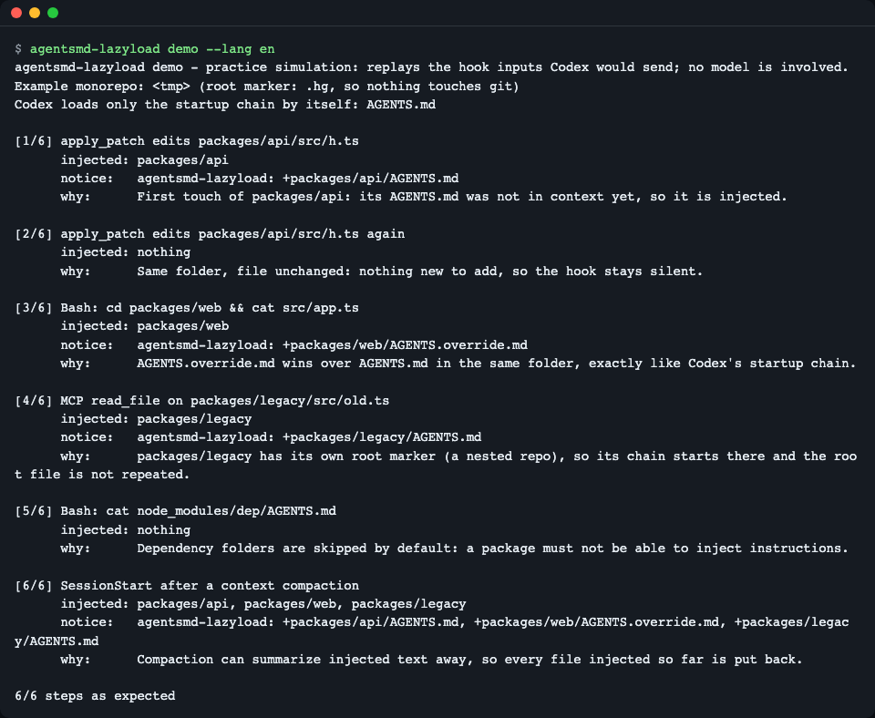
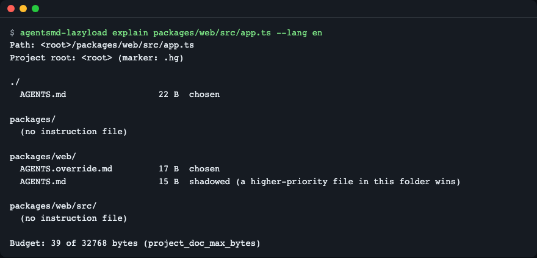
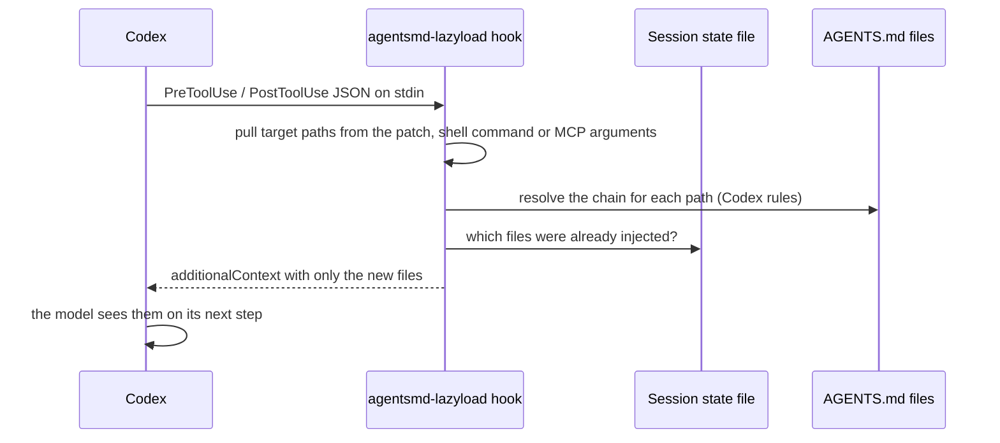

# agentsmd-lazyload

**English** | [한국어](README.ko.md)

A Codex hook that loads a nested `AGENTS.md` into the model's context the first time a tool call touches that folder, so a session opened at a monorepo root still follows each package's own instructions. It follows Codex's own chain rules and needs no API key and no network. Install with `npm i -g agentsmd-lazyload && agentsmd-lazyload install`.

Codex builds its `AGENTS.md` chain once, when the session starts: project root down to the folder you launched from. If you open Codex at the repo root and then edit `packages/api/`, `packages/api/AGENTS.md` is never read ([openai/codex#12115](https://github.com/openai/codex/issues/12115), open, checked 2026-11-20). This hook fills that gap while the session runs.


*`agentsmd-lazyload demo`: six sample hook inputs on a throwaway monorepo. This is a practice simulation, no model is involved.*

## What it adds

- Injects the nested `AGENTS.md` for a folder the first time a tool call (`apply_patch`, shell command, MCP tool) touches it.
- Uses Codex's own rules: `AGENTS.override.md` wins over `AGENTS.md`, then `project_doc_fallback_filenames`, empty files are skipped, `project_root_markers` and nested repositories set the boundary, `project_doc_max_bytes` truncates.
- Remembers what it injected per session, so nothing is added twice, and puts it back after a context compaction.

## Requirements

| Host | Version checked | Notes |
|---|---|---|
| Codex CLI | 0.154.0 | Hooks are read from `~/.codex/hooks.json` or `<project>/.codex/hooks.json`. Hooks must be trusted once (see below). |
| Node.js | 26.13.0 (needs 22 or newer) | Install: `brew install node` or see [nodejs.org](https://nodejs.org/). |

## Install

Global install, then register the hooks:

```bash
npm i -g agentsmd-lazyload
agentsmd-lazyload install            # writes ~/.codex/hooks.json
# or only for one repo:
agentsmd-lazyload install --project  # writes <project root>/.codex/hooks.json
```

Preview first, nothing is written:

```bash
agentsmd-lazyload install --project --dry-run
```

It prints the three events it would add and the full `hooks.json`:

```
Dry run: nothing was written. This is what install would do:
  + PreToolUse
  + PostToolUse
  + SessionStart
```

Then start Codex, open `/hooks`, and review and trust the new hooks. **Hooks do nothing until they are trusted.**

To remove only what `install` added: `agentsmd-lazyload uninstall` (add `--project` for the repo-level file). Your other hooks are kept.

From a clone instead of npm:

```bash
git clone https://github.com/LeeGyeongPil/agentsmd-lazyload.git
cd agentsmd-lazyload
npm install          # builds dist/ via the prepare script
node dist/cli.js install
```

`--project` writes into the project root (the folder with `.git`, or your `project_root_markers`) even when you run it from a subfolder, and prints the chosen path. `install` recognises its own entries by their command, whatever the folder is called, so running it twice never adds a duplicate and `uninstall` removes only those entries.

If `agentsmd-lazyload` is not on your `PATH`, `install` writes the absolute path of `node` and `cli.js` into `hooks.json` and tells you. Run `install` again if you move or upgrade it, or if the path of `node` changes (for example after `brew upgrade node`).

## Usage

### Try it without Codex (practice simulation)

```bash
npm install
npm start            # same as: node dist/cli.js demo --lang en
```

`demo` builds a throwaway monorepo and replays the hook inputs Codex would send. It is a practice (mock) mode: no model and no real Codex session are involved, so it shows what the hook injects, not how a model reacts. It ends with `6/6 steps as expected`. The six steps cover a first touch, a repeat touch (silent), `AGENTS.override.md` winning, a nested repo boundary, a skipped dependency folder, and re-injection after compaction. Korean output: `node dist/cli.js demo --lang ko`.

### See which files apply to a path

```bash
agentsmd-lazyload explain packages/web/src/app.ts
```


*`explain` lists every folder from the project root to the target, the file chosen in each, and the byte budget used.*

`chosen` files are injected; `shadowed` files lose to a higher-priority file in the same folder. Add `--json` for machine-readable output.

### What the hook receives and returns

Codex sends one JSON object on stdin. The fields the hook uses are `session_id`, `cwd` (absolute), `hook_event_name`, `tool_name` and `tool_input`; other fields are ignored. For an `apply_patch` that updates `packages/web/src/app.ts` in a repo at `/work/repo`, the input looks like this (one line, shown wrapped here):

```json
{"session_id":"s1","cwd":"/work/repo","hook_event_name":"PreToolUse","tool_name":"apply_patch",
 "tool_input":{"command":"*** Begin Patch\n*** Update File: packages/web/src/app.ts\n@@\n-a\n+b\n*** End Patch\n"}}
```

The first call prints (one line, shown wrapped here):

```json
{"systemMessage":"agentsmd-lazyload: +packages/web/AGENTS.override.md",
 "hookSpecificOutput":{"hookEventName":"PreToolUse",
  "additionalContext":"Nested AGENTS.md instructions apply to the files this tool call touches (deeper files override shallower ones):\n\n# AGENTS.md instructions for packages/web\n\nApplies to files under packages/web/. Deeper AGENTS.md files override shallower ones.\n\n<INSTRUCTIONS>\nWeb: use vitest.\n</INSTRUCTIONS>"}}
```

The identical second call prints nothing and exits 0. `systemMessage` is a short notice for you; `additionalContext` goes to the model and is always English.

### Screen language

CLI output is English or Korean: `--lang en|ko` wins over `AGENTSMD_LAZYLOAD_LANG`, which wins over `LC_ALL`, `LC_MESSAGES` and `LANG`. Anything that is not Korean falls back to English. The hook has no `--lang` flag, so its notice follows the environment variables.

## Configuration

The hook reads Codex's own settings from `$CODEX_HOME/config.toml` (default `~/.codex`), overridden by the project's `.codex/config.toml`:

| Key | Default | Description |
|---|---|---|
| `project_doc_max_bytes` | `32768` | Byte budget for instruction files. The last file is truncated to what is left. |
| `project_doc_fallback_filenames` | `[]` | Extra file names tried when a folder has no `AGENTS.override.md` or `AGENTS.md`. |
| `project_root_markers` | `[".git"]` | Files or folders that mark the project root. |

Environment variables (all optional, see `.env.example`):

| Variable | Default | Description |
|---|---|---|
| `AGENTSMD_LAZYLOAD_LANG` | from `LANG` | Output language `en` or `ko`. |
| `AGENTSMD_LAZYLOAD_STATE_DIR` | `$XDG_STATE_HOME/agentsmd-lazyload` or `~/.local/state/agentsmd-lazyload` | Where per-session state is kept. `PLUGIN_DATA`, set by Codex for bundled hooks, takes precedence. |
| `AGENTSMD_LAZYLOAD_EXCLUDE` | `node_modules,.venv,venv,vendor,third_party,.git,dist,build` | Folder names to skip. An empty or comma-only value falls back to this default; it does not turn the guard off. |
| `AGENTSMD_LAZYLOAD_DISABLE` | unset | `1` makes the hook do nothing, an escape hatch if Codex adds native nested loading. |
| `CODEX_HOME` | `~/.codex` | Codex home holding `config.toml`. |

## How it works



1. Codex calls the hook before and after `apply_patch`, shell and MCP tool calls. Both are hooked because some tool calls have been reported to skip one of them ([openai/codex#16732](https://github.com/openai/codex/issues/16732)); the state file prevents a double injection.
2. The hook extracts the paths the call touches: patch headers, `cd`/`pushd`/`git -C`/`bash -lc` in commands, and path-like MCP arguments, at most 64.
3. For each path it walks from the project root down, picking one file per folder with Codex's rules.
4. Files already injected in this session are skipped. A changed file is injected again as updated.
5. After compaction (`SessionStart` with `compact`) it puts back every file it injected so far, because summaries can drop injected text. `clear` resets the state silently.

What it can access: it reads instruction files and `config.toml`, and writes one small state file per session in the state directory. It makes no network calls. Dependency folders are skipped and paths outside the project root, including symlinks that escape it, are ignored, so a package cannot inject instructions through `node_modules`. Any error ends with exit code 0, empty stdout and one line on stderr, so a hook problem never blocks Codex.

## When to use it

- Good fit: you open Codex at a monorepo root and move between packages that each have their own `AGENTS.md`.
- Good fit: you want Codex's file precedence and byte budget respected instead of hand-written routing sentences in the root file.
- Other options: a single package or a repo with one root `AGENTS.md` needs nothing extra. If you only work in one package at a time, launching Codex there with `codex --cd <dir>` is built in. If Codex ships native nested loading, set `AGENTSMD_LAZYLOAD_DISABLE=1` or run `uninstall`.

## Limitations

- Each hooked tool call starts a fresh `node` process: about 0.1 s of CPU per call (measured here: 0.09 s user, 0.15 s total for an ignored input).
- `codex -c` overrides and `--profile` settings are not visible to hooks.
- The global `$CODEX_HOME/AGENTS.md` is not counted in the byte budget (only the project chain is).
- Injected text stays in the conversation history and cannot be removed. Two overlapping parallel tool calls may inject the same file twice at worst.
- Shell parsing handles simple commands only (no variables, globs or subshells).
- `additionalContextLimit: 0` ("no limit") follows the Codex docs; I could not confirm it in a live session.

## Verify in a real session

I could not run an end-to-end session with a real model in my environment (Codex login was unavailable). Hook input and output follow the hook schema in the Codex 0.154.0 binary and the docs, and the chain logic is checked against `codex debug prompt-input` by `npm run test:conformance`. To verify it yourself:

1. Install the hooks and trust them in `/hooks`.
2. Open Codex at a repo root that has `packages/<x>/AGENTS.md` with a distinctive sentence.
3. Ask it to edit a file under that package.
4. You should see the `agentsmd-lazyload: +packages/<x>/AGENTS.md` notice, and the model should follow that sentence.
5. Optional: compare with `codex debug prompt-input` run inside `packages/<x>/`; the startup chain printed there should contain the same file you saw injected.

## Desktop plugin (optional)

The repo root also holds a Codex plugin bundle: `plugin.json` (name, version, description) and `hooks/hooks.json` (the same three events as `install`, with the command `node "$PLUGIN_ROOT/dist/cli.js" hook`). Plugin hooks are supported only for a plugin you install manually in the Codex desktop app; public plugin directories cannot ship them ([plugin docs](https://developers.openai.com/codex/plugins/build.md), checked 2026-11-20). To use it, clone and build the repo (`npm install`), then add that folder as a local plugin in the desktop app and trust its hooks. I did not test the desktop app. CLI users should use `install`, which writes `hooks.json` directly.

## Code tour

- `src/resolve.ts`: finds the project root and picks one file per folder with Codex's rules, then applies the byte budget.
- `src/extract.ts` with `src/shell.ts`: turn a patch, a shell command or MCP arguments into the paths a call touches.
- `src/hook.ts`: reads the JSON from stdin, asks `resolve` what is new using the per-session state in `src/state.ts`, and prints the answer. Any error ends with exit code 0.

## Glossary

- **Hook**: a command Codex runs at a fixed moment (before or after a tool call, at session start) and feeds a JSON object on stdin.
- **`additionalContext`**: text a hook returns that Codex adds to what the model sees.
- **Instruction chain**: the `AGENTS.md` files from the project root down to one folder.
- **Compaction**: Codex summarizing a long conversation to save space; injected text can be lost in it.
- **Fail-open**: on an error the hook does nothing and lets Codex continue.

## Troubleshooting

| Symptom | Cause | Fix |
|---|---|---|
| Nothing is injected | Hooks were added but not trusted | Open `/hooks` in Codex and trust them |
| Nothing is injected | `AGENTSMD_LAZYLOAD_DISABLE=1` is set | Unset it |
| A folder's file is not injected | The folder is in the exclude list (for example `vendor`) | Change `AGENTSMD_LAZYLOAD_EXCLUDE` |
| A file is cut off or "overflow" notice | `project_doc_max_bytes` budget is used up | Raise it in `config.toml`, or shorten the files |
| Root file is not injected for a file in a nested repo | The nested repo has its own root marker, so its chain starts there | Expected, see the nested repo boundary step of the demo |
| `hooks.json` has an absolute path that no longer exists | The package was moved or upgraded, or `node` was upgraded to a new path (for example `brew upgrade node`) | Run `agentsmd-lazyload install` again |
| `install` exits with code 3 | The existing `hooks.json` is not valid JSON | Fix the file; it is left unchanged |

## Development

```bash
npm install                # builds dist/
npm test                   # 106 tests
npm run test:conformance   # needs codex on PATH, otherwise prints "skipped: codex not found"
```

Release notes are in [CHANGELOG.md](CHANGELOG.md).

## Learn more

- [Codex hooks](https://learn.chatgpt.com/docs/hooks) (checked 2026-11-20)
- [Codex plugin build guide](https://developers.openai.com/codex/plugins/build.md) (checked 2026-11-20)
- [openai/codex#12115](https://github.com/openai/codex/issues/12115): nested `AGENTS.md` is not loaded after the session starts (checked 2026-11-20)
- [openai/codex#16732](https://github.com/openai/codex/issues/16732): tool calls that skip a hook (checked 2026-11-20)

## License

MIT.
